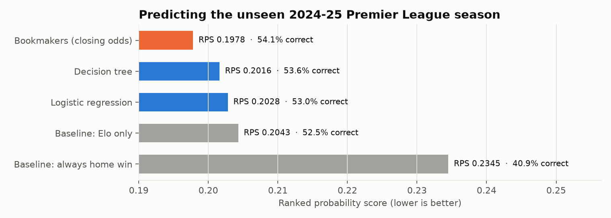
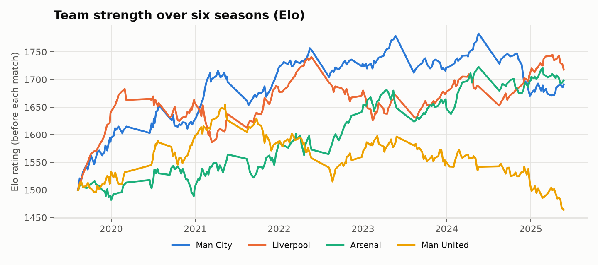
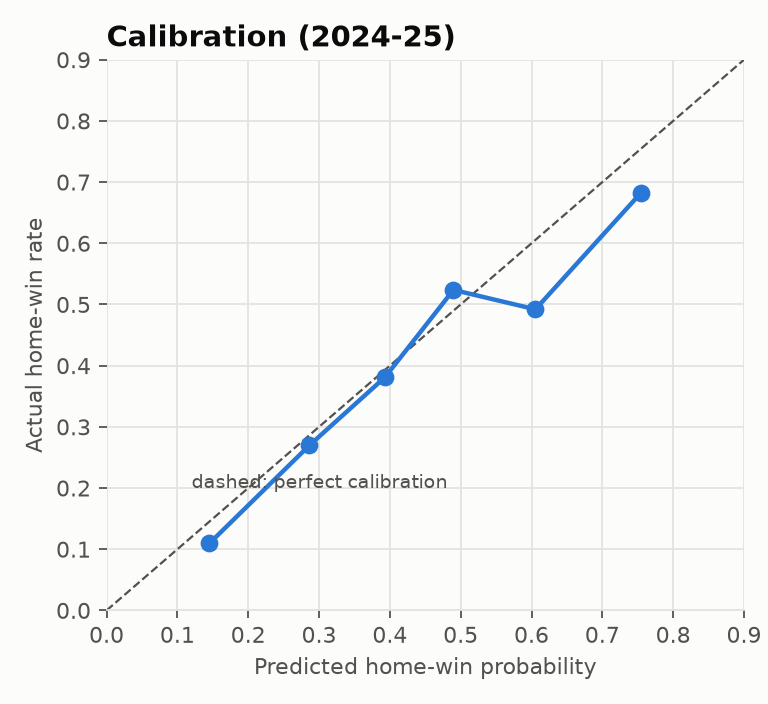
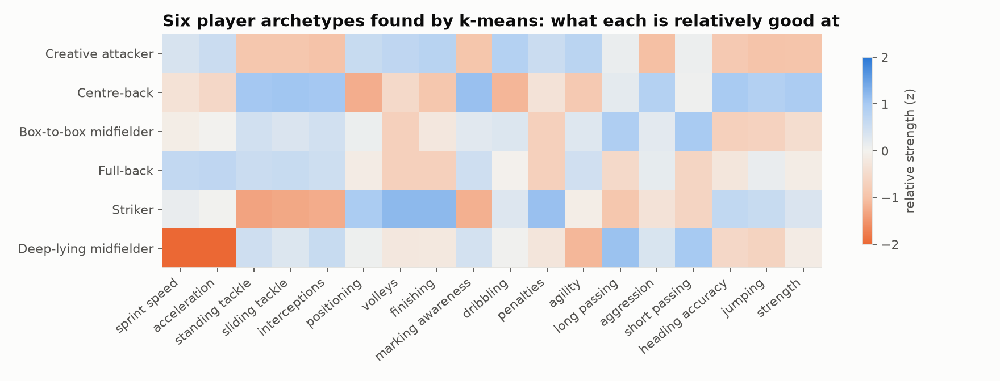

# Football Analytics Platform

An end-to-end sports analytics project: **predict Premier League results** and **discover player
archetypes** with clustering, with a SQLite data layer, a Streamlit app, tests and basic security practices.

It started as a plan for a "sports analytics platform" (data mining + information security), and the
build follows that plan step by step: scope → data → cleaning → SQL storage → clustering and
classification → security → UI → testing → documentation.

**🔗 Live app: https://football-analytics-platform-jkjibgwvi6bvr9cknbklu8.streamlit.app/** (may take ~30 seconds to wake up if nobody has used it recently)



## Results

### Match outcome prediction (home / draw / away)
Trained on 2019-20 → 2023-24 (~1,880 matches), tested on the **2024-25 season (379 matches)**,
which the models never saw. Features are built only from matches played *before* kick-off.

| Model | Accuracy | Ranked probability score ↓ | Log loss ↓ |
|---|---:|---:|---:|
| Always predict home win | 40.9% | 0.2345 | 1.080 |
| Elo rating only | 52.5% | 0.2043 | 0.993 |
| **Logistic regression** (Elo + form) | 53.0% | 0.2028 | 0.989 |
| **Decision tree** (depth 4) | 53.6% | 0.2016 | 0.993 |
| Bookmakers' closing odds | 54.1% | 0.1978 | 0.972 |

- Both models beat the Elo baseline and get within about one point of accuracy of the **bookmakers**, the
  hardest benchmark in sports prediction.
- A "value bet" backtest (bet when the model's probability beats the bookmaker's by 5+ points) placed
  150 bets and **lost 3%**. The model is good, but closing odds are better. That's the expected
  result, and the backtest is there to show it honestly.
- The predicted probabilities are well calibrated up to about 55%: when it says 40%, home teams win about 38% of the time. Above 60% it's slightly overconfident.

| | |
|---|---|
|  |  |

### Player archetypes (k-means)
Clustered **16,343 outfield players** from EA SPORTS FC 26 on 29 detailed attributes. Each player's
attributes are standardised against their *own* average first, so clusters capture **style, not
quality**. k = 6 was chosen by silhouette score.

| Archetype | Players | Example |
|---|---:|---|
| Centre-back | 3,833 | van Dijk, Saliba, Marquinhos |
| Creative attacker | 3,431 | Salah, Dembélé, Lamine Yamal |
| Full-back | 3,010 | Hakimi, Nuno Mendes, Davies |
| Striker | 2,944 | Mbappé, Haaland, Kane |
| Box-to-box midfielder | 2,198 | Bellingham, Pedri, Caicedo |
| Deep-lying midfielder | 927 | Rodri, Kimmich, Partey |



### Predicting player potential
A logistic regression on current attributes + age identifies which under-21s EA rates as **80+
potential** with **ROC AUC 0.93** (4,250 young players, 675 high-potential). Age (younger = higher
potential), ball control and reactions carry the most weight.

## App

```bash
streamlit run app/streamlit_app.py
```
The app builds its own database and model on first launch, so it deploys to
[Streamlit Community Cloud](https://share.streamlit.io) as-is (main file: `app/streamlit_app.py`).
- **Match predictor:** pick any two teams for win/draw/loss probabilities from current Elo and form
- **Player archetypes:** look up a player's archetype and the 8 most similar players by style
- **Team history:** season-by-season record and recent results (served by a parameterised SQL query)

## Run it

```bash
git clone https://github.com/kammy04/football-analytics-platform.git
cd football-analytics-platform
pip install -r requirements.txt
python scripts/run_pipeline.py     # downloads data, builds data/football.db, trains, writes figures/ + reports/
pytest -q                          # 7 tests: leakage, Elo, form, metrics, SQL injection, read-only DB
streamlit run app/streamlit_app.py
```

## How it works

```
football-data.co.uk  ─┐                         ┌─ features.py   Elo (home adv., margin of victory,
 6 EPL seasons (CSV)  ├─ db.py ─► SQLite ──────┤                 season regression) + last-5 form
EA FC 26 players     ─┘   football.db          │  matches.py    logistic regression / decision tree,
                          (indexed, read-only  │                baselines, RPS, calibration, backtest
                           for the app)        └─ players.py    per-player standardisation, k-means,
                                                                nearest-neighbour similarity, potential model
```

- **No leakage:** each match's features are recorded *before* that match updates the Elo and form state.
  `test_features_use_only_past_matches` changes a result and checks only later matches are affected.
- **Ranked probability score** is the standard metric for football because it respects the ordering
  home > draw > away (predicting a draw when the home team wins is "less wrong" than predicting an away win).
- **Security:** parameterised queries, read-only DB connection, input whitelisting. See [SECURITY.md](SECURITY.md).

## Project layout
```
src/football/   db.py · features.py · matches.py · players.py · charts.py
scripts/        run_pipeline.py
app/            streamlit_app.py
tests/          test_features.py
reports/        summary.json, model results, player archetypes
figures/        charts in this README
```

## Future work
- **NBA.** The original plan covered basketball too. Adding NBA player stats (per-36 and advanced) to the
  clustering module needs a stats source that allows automated downloads (stats.nba.com timed out and
  Basketball-Reference limits automated access).
- Expected-goals (xG) features instead of shots on target
- Deploy the app to Streamlit Community Cloud

**Tech:** Python · pandas · scikit-learn · SQLite · Streamlit · matplotlib · pytest

*Data: [football-data.co.uk](https://www.football-data.co.uk/) match results and odds; EA SPORTS FC 26
player data via [EAFC26-DataHub](https://github.com/ismailoksuz/EAFC26-DataHub). Downloaded at run time.*
